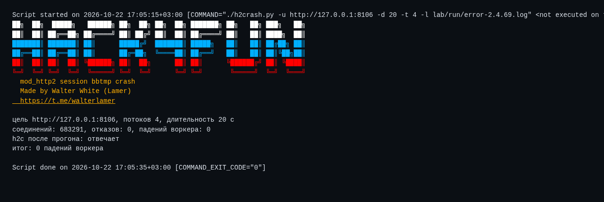

<div align="center">

# 💥 h2crash

**Краш mod_http2 · CVE-2026-57941**

[](https://httpd.apache.org/)
[](https://www.python.org/)
[](https://github.com/wwlamer)
[](https://t.me/walterlamer)

[🐙 GitHub](https://github.com/wwlamer) · [💬 Telegram](https://t.me/walterlamer) · [📚 Документация](docs/DOCUMENTATION.md)

</div>

> 💡 **Коротко:** незаутентифицированный клиент по h2c отправляет `HEADERS` и `RST_STREAM` одним пакетом, затем отдельный кадр. Общий `session->bbtmp` чистится внутри feed-цикла, внешний цикл освобождает тот же bucket повторно. Двойное освобождение, цикл во freelist, падение воркера. Это **отказ в обслуживании**, не выполнение кода.

[📦 Установка](#install) · [🚀 Старт](#start) · [🕹️ Режимы](#modes) · [🧩 Флаги](#flags) · [✅ Проверено](#tested) · [🖼️ Скриншоты](#shots) · [📚 Документация](docs/DOCUMENTATION.md)

<a id="install"></a>
## 📦 Установка

```bash
git clone https://github.com/wwlamer/h2crash.git
cd h2crash
chmod +x h2crash.py
./h2crash.py --help
```

🐍 Сторонних пакетов нет, только стандартная библиотека Python 3.8+.

<a id="start"></a>
## 🚀 Быстрый запуск

```bash
./h2crash.py -u http://TARGET:PORT
```

⚙️ По умолчанию: 4 потока, 30 секунд, режим `crash`. Адрес обязателен, остальное подставляется само.

📝 Чтобы считать падения, укажите лог сервера:

```bash
./h2crash.py -u http://127.0.0.1:8094 -l /var/log/httpd/error_log -d 60 -t 8
```

ℹ️ Без `-l` скрипт гоняет трафик, но падения не считает: смотрите `error_log` на стороне сервера.

<a id="modes"></a>
## 🕹️ Режимы

| Режим | Что делает |
|---|---|
| 💥 `crash` | отправляет триггер и считает `AH00051` и `AH00052` в логе |
| 🔍 `check` | только проверяет, что сервер отвечает по h2c |

<a id="flags"></a>
## 🧩 Флаги

| Флаг | Значение |
|------|----------|
| `-u, --url` | 🎯 адрес цели, обязателен |
| `-d, --duration` | ⏱️ длительность прогона в секундах |
| `-t, --threads` | 🧵 число одновременных соединений |
| `-l, --log` | 📄 путь к `error_log` для подсчёта падений |
| `-m, --mode` | 🕹️ `crash` или `check` |
| `-j, --json` | 🤖 машинный вывод |
| `-q, --quiet` | 🔇 без баннера и служебных строк |
| `-p, --plain` | 🎨 без цветов |
| `-v, --version` | 🏷️ версия |
| `-h, --help` | ❓ справка |

<a id="tested"></a>
## ✅ Проверено

- 💥 **2.4.68**, сборка из официального тарбола: 21 падение воркера за 20 секунд, 4 потока, 196 соединений. В соседних прогонах было от 12 до 15.
- ✅ **2.4.69**, та же сборка и тот же триггер: **0 падений** за 20 секунд, 683 291 соединение.
- 😴 Простой без трафика: 0 падений.

📊 Логи: `logs/positive.log` и `logs/negative.log`.

🎲 Разброс между прогонами есть: триггер зависит от планировщика. На практике серия из нескольких запусков даёт от 7 до 21 падений за 20 секунд.

<a id="shots"></a>
## 🖼️ Скриншоты

Реальные прогоны на локальном стенде, вывод снят с терминала.

💥 Уязвимая версия:


✅ Исправленная версия:



## ⚠️ Ограничения

- 🚫 Это **не RCE**. Падает воркер, MPM поднимает новый. Устойчивый поток триггеров держит пул в цикле падений.
- 🔌 Нужен включённый h2c (`Protocols h2c http/1.1`), без TLS.
- 📄 Подсчёт падений требует доступа к `error_log` цели. Без него видно только деградацию.
- 📦 В затронутый диапазон входят 2.4.0 по 2.4.68. Проверялись 2.4.68 и 2.4.69.

📚 Полное описание механизма, разбор исходников и порядок воспроизведения: [docs/DOCUMENTATION.md](docs/DOCUMENTATION.md).
